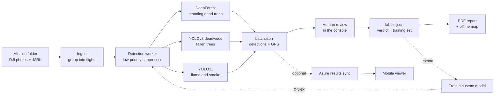

# Wildfire Hazard Detection System

**An offline desktop app that turns drone photos of forest into a reviewed, GPS-accurate
map of wildfire hazards and a PDF field report.**

It detects **standing dead trees**, **fallen trees**, **flame** and **smoke** in DJI survey
imagery, lets an operator confirm or correct every detection, and needs no internet in the field.


> SAIT capstone project (2026), independent of SAIT. **No drone imagery is included:** the
> development photos were provided under the capstone agreement and cannot be redistributed.

## Contents

- [Highlights](#highlights)
- [Tour](#tour)
- [How it works](#how-it-works)
- [Limits](#limits)
- [Getting started](#getting-started)
- [Project structure](#project-structure)
- [Configuration](#configuration)
- [Cloud sync](#cloud-sync)
- [Training your own model](#training-your-own-model)
- [Testing](#testing)
- [Documentation](#documentation)
- [Team](#team)
- [Credits and licences](#credits-and-licences)

## Highlights

- **Fully offline** - local GPU (CUDA, Apple Metal, or CPU) and cached satellite tiles.
- **Human review** - model output is a proposal; only confirmed boxes reach the report.
- **Review becomes training data** - confirmed boxes export to train a better model.

## Tour

**1. Scans.** Point it at an SD-card dump; photos are grouped into flights by capture time.
Detect a flight in the background - every page shows progress and time left, and the
desktop app notifies you when it is done.


**2. Scan detail.** Boxes drawn live over the full-resolution photo, filterable by type,
with sizes in metres and a minimap while zoomed. Scans from an older detector are tagged
and can be re-detected.


**3. Review.** Delete, relabel or draw boxes, mostly from the keyboard (press `?`). Unsaved
work is guarded and kept as a local draft.


**4. Map.** All hazard sites on offline imagery, filtered by month and type. Photos within
40 m merge into one site.


**5. Report.** A PDF that leads with conclusions: summary, hazard map, optional local-LLM
analysis, then the evidence.

| Cover | Hazard map |
|---|---|
|  |  |

A separate phone app in [`mobile/`](mobile/README.md) guides a crew to each site using
results synced from Azure.

## How it works



- **Scale matching.** Each frame's ground resolution is computed from EXIF and the frame is
  resampled to the scale each model was trained on - at the drone's native 1.4 cm/px the
  crown model mistakes branches for trees.
- **Tiled inference** with [SAHI](https://github.com/obss/sahi), so small objects in
  5280x3956 frames are not lost.
- **GPS** from DJI RTK `.MRK` files when present (centimetre grade), otherwise EXIF.
- **Severity** (High / Medium / Low) is display-only: flame is High, smoke at least Medium,
  trees grade by density per frame.

## Limits

| Hazard | Model | Caveat |
|---|---|---|
| Standing dead tree | [DeepForest](https://github.com/weecology/DeepForest) + [alive/dead classifier](https://huggingface.co/weecology/cropmodel-deadtrees) | Misses trees that lost their crown; the box covers the crown, not the trunk |
| Fallen tree | [YOLOv8 deadwood](https://huggingface.co/mayrajeo/yolov8-deadwood) | Trained on Finnish forest; a long log may count as several |
| Flame, smoke | [YOLO11 fire detector](https://huggingface.co/leeyunjai/yolo11-firedetect) | Trained on ground photos; needs 0.60 confidence |
| Your own | Any ONNX or YOLO `.pt` in `models/` | Picked up automatically |

RGB cannot reliably tell dead wood from bare ground, so **every detection needs review**.
Flame recall from the air is unmeasured (no fire imagery available): treat a flame marker
as "look at this photo", and its absence as no information.

## Getting started

Windows 10/11 or macOS 11+, Python 3.13, 8 GB RAM, ~15 GB disk. Details in [MANUAL.md](MANUAL.md).

**Install:** double-click `install-windows.bat` or `install-macos.command`. Or by hand:

```bash
python3.13 -m venv .venv && source .venv/bin/activate     # Windows: py -3.13 -m venv .venv; .venv\Scripts\activate
pip install -r requirements-mac.txt                        # Windows: requirements-win-cuda.txt (PyTorch first)
pip install -r requirements.txt -r requirements-deadtree.txt
python -m scripts.install_desktop_app                      # desktop shortcut
```

**First run (online):** Settings -> *Download missing models*, then download map tiles for
your area on the Map page.

**Run:** the desktop app, or `python -m src.wildfire.console --desktop`
(also served at `http://127.0.0.1:7861`). Headless: `python -m scripts.run_detection <folder> --pdf`.

## Project structure

```
src/wildfire/            detection pipeline, GPS, data model, PDF report
src/wildfire/console/    the app: FastAPI server, pages, desktop window
mobile/                  Expo phone viewer
scripts/                 installer, CLI tools, model/map downloads, label export
tests/                   pytest suite
branding/ config/        logo and colours; settings.example.json
models/ map/ outputs/    weights, tiles, run results (gitignored)
```

Each run is a self-contained folder: `batch.json` (detections), `labels.json` (the review),
image renditions, and timestamped PDFs. Stack: PyTorch, Ultralytics, SAHI, DeepForest, ONNX
Runtime, FastAPI, pywebview, Leaflet, ReportLab. The frontend has no build step, so installing
needs only Python.

## Configuration

Everything is on the **Settings** page (engineering options under *Advanced*) and stored in
`config/settings.json`. The ones that shape results:

| Setting | Default | Effect |
|---|---|---|
| `conf_threshold` | 0.30 | Minimum confidence |
| `class_conf_thresholds` | Flame/Smoke 0.60 | Stricter floor per type |
| `df_target_gsd_cm` | 4.0 | Ground resolution for the crown model |
| `severity_deadtrees_high` / `_medium` | 39 / 13 | Dead trees per frame for High / Medium |
| `severity_fallen_high` / `_medium` | 46 / 7 | Fallen trees per frame for High / Medium |
| `report_max_image_pages` / `report_detail_pages` | 30 / 4 | Images in the PDF / with a full page |

Recalibrate the severity thresholds if you change a detector.

## Cloud sync

Optional and off by default. Shares runs through an Azure Blob container - **results only**
(a ~50 KB JSON per run; photos stay local) or the full folder as a backup. Use a
container-scoped SAS URL, not the account key. Setup in [TEAM_GUIDE.md](TEAM_GUIDE.md).

## Training your own model

```bash
python -m scripts.export_labels outputs/<run>
python -m scripts.upload_to_custom_vision <export_dir> --endpoint <url> --key <key> --project-id <guid>
# train on customvision.ai, export ONNX, drop it into models/
```

## Testing

```bash
pip install -r requirements-dev.txt
pytest -q
```

Runs on Windows and macOS; tests needing model weights skip themselves.

## Documentation

[MANUAL.md](MANUAL.md) for operators - [TEAM_GUIDE.md](TEAM_GUIDE.md) for maintainers -
[AGENTS.md](AGENTS.md) for developers - [INSTALL.md](INSTALL.md) for packaging -
[PLAN.md](PLAN.md) for history - [CONTRIBUTORS.md](CONTRIBUTORS.md).

## Team

| Member | Role |
|---|---|
| **Huajie Zeng** | System structure, back-end, AI-assisted development; detection pipeline, operations console, GPS/RTK, PDF reports, offline maps, macOS support, test suite |
| **Luna McCormick** | Team leader: project management in Jira, UI/UX feedback, original brand identity, poster |
| **Sagar Kumbhar** | System structure and front-end support; the mobile field viewer |
| **Tessa Feyres** | QA and project feedback; the original cloud-sync module, console accessibility |

## Credits and licences

- **Dead trees:** [DeepForest](https://github.com/weecology/DeepForest) (Weecology, MIT).
- **Fallen trees:** Mayra et al. (2025), *Using UAV images and deep learning to enhance the
  mapping of deadwood in boreal forests*, Remote Sensing of Environment 329, 114906
  ([doi](https://doi.org/10.1016/j.rse.2025.114906)); weights AGPL-3.0.
- **Flame and smoke:** [leeyunjai/yolo11-firedetect](https://huggingface.co/leeyunjai/yolo11-firedetect).
- **Inference:** [Ultralytics](https://github.com/ultralytics/ultralytics) (AGPL-3.0), [SAHI](https://github.com/obss/sahi) (MIT).
- **Maps:** Esri World Imagery (offline export permitted); OpenStreetMap contributors.

No licence file yet, so the code is not licensed for reuse. Note the AGPL-3.0 dependencies
when choosing one.
