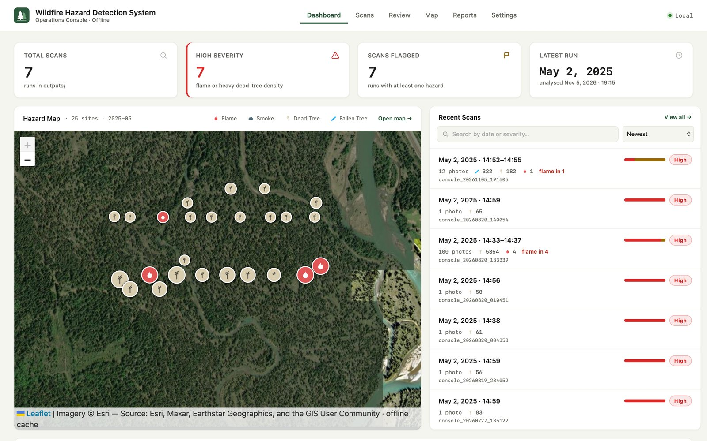
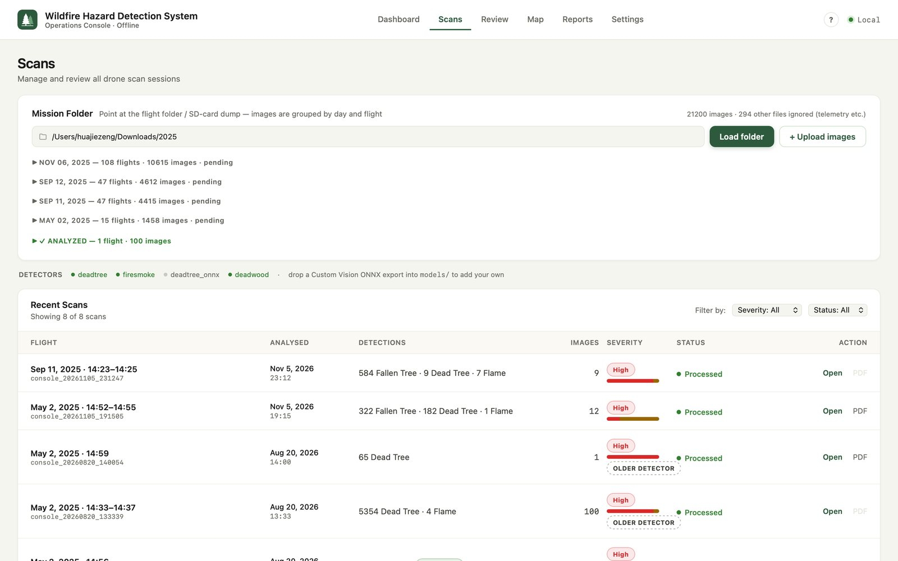
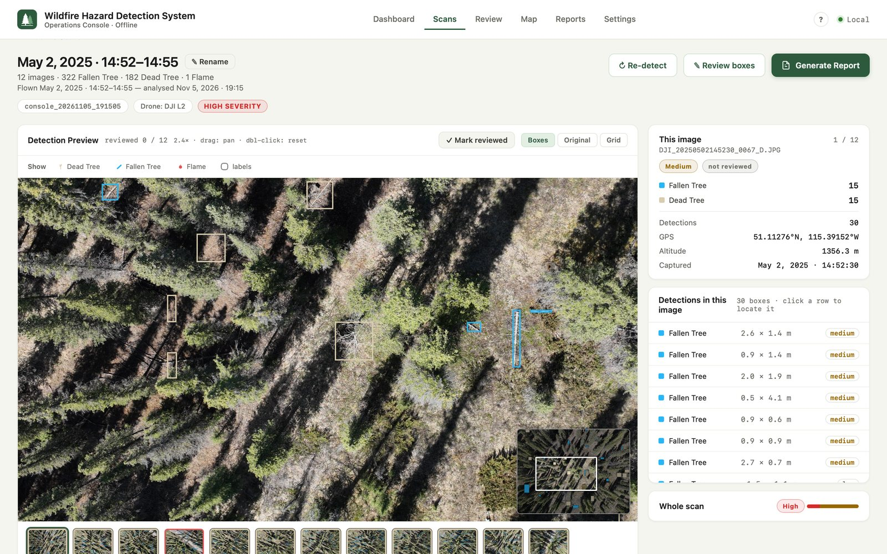
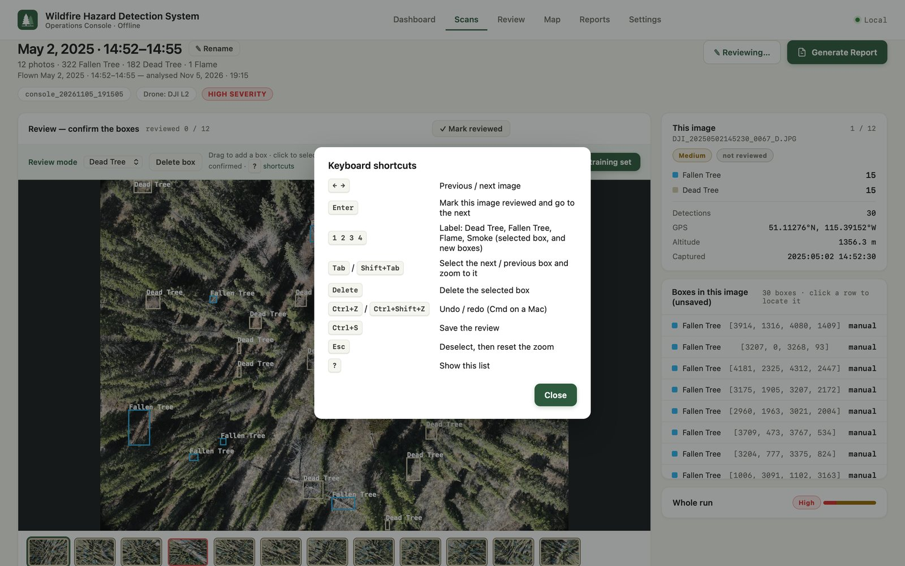
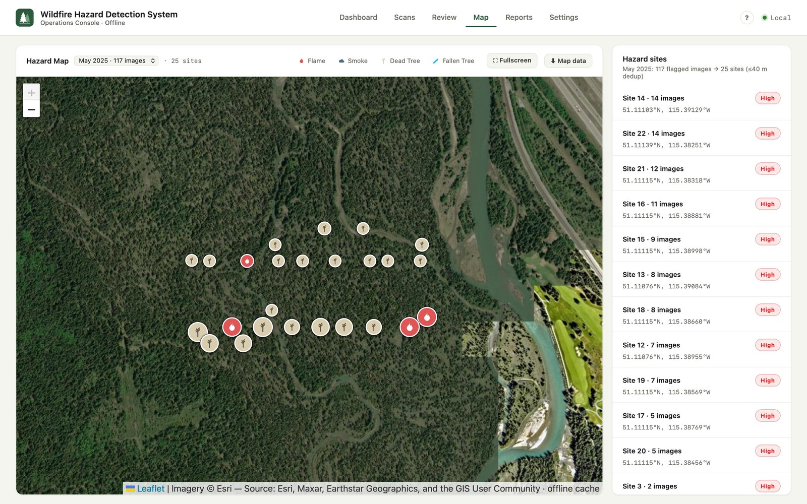
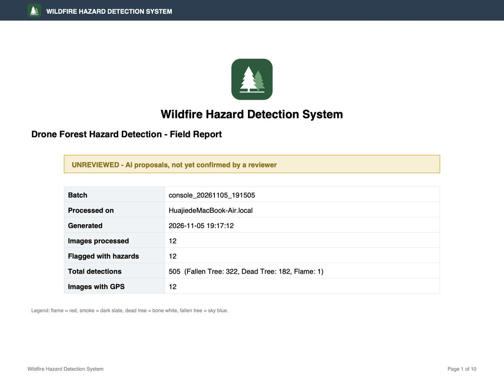
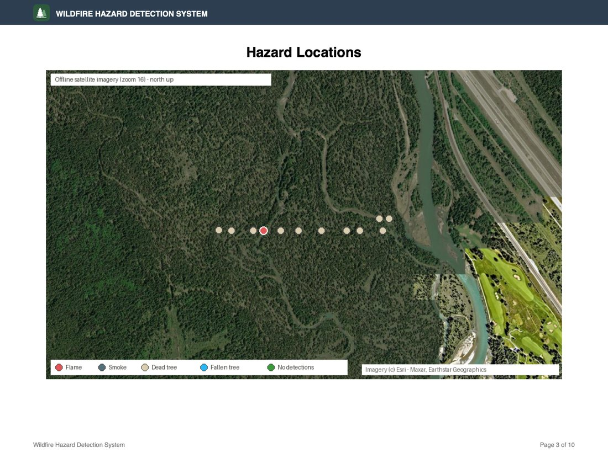
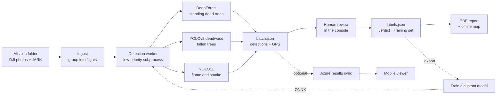

# Wildfire Hazard Detection System

**An offline desktop application that turns drone photos of forest into a reviewed,
GPS-accurate map of wildfire hazards and a PDF field report.**

It finds **standing dead trees**, **fallen trees** (surface fuel), **flame** and
**smoke** in DJI survey imagery, lets a person confirm or correct every detection,
and produces a report a forestry or fire crew can take into the field - with no
internet connection at any point.



> Built as a capstone project at SAIT (2026). It is an independent student project,
> not a SAIT product, and does not carry the institution's branding. **No drone
> imagery is included in this repository:** the flight photos used during development
> were provided under the capstone agreement and are not redistributable. The
> screenshots show the application working on that imagery; point it at your own
> mission folder to try it.

---

## Contents

- [Why it exists](#why-it-exists)
- [A tour of the application](#a-tour-of-the-application)
- [How it works](#how-it-works)
- [What it detects - and what it cannot](#what-it-detects---and-what-it-cannot)
- [Getting started](#getting-started)
- [A typical field workflow](#a-typical-field-workflow)
- [Project structure](#project-structure)
- [Configuration](#configuration)
- [Cloud sync (optional)](#cloud-sync-optional)
- [Training your own model](#training-your-own-model)
- [Testing](#testing)
- [Documentation map](#documentation-map)
- [Team](#team)
- [Credits and licences](#credits-and-licences)

---

## Why it exists

Crews clearing wildfire fuel fly drones over forest and come back with thousands of
photos. Finding the hazardous trees in them by eye is slow, and the places that need
the work - backcountry, fire-damaged stands - usually have no connectivity.

This tool does the first pass automatically and keeps a human in charge of the
result:

- **Fully offline.** Detection runs on the laptop's own GPU (CUDA on Windows, Metal on
  Apple Silicon, CPU anywhere). Maps come from a tile cache downloaded once. The
  network is needed only for setup downloads.
- **Review is the accuracy guarantee.** Every model output is a *proposal*. An operator
  confirms, deletes, relabels or draws boxes in the built-in editor, and only the
  confirmed result goes into the report.
- **The review is also the training set.** Confirmed boxes are saved as `labels.json`
  and can be exported to train a better model, so the system improves with use.

## A tour of the application

### Dashboard
Hazard sites across every run on an offline satellite map (legend chips filter by
hazard type), recent scans with each run's severity mix, and the review backlog.
See the screenshot above.

### Scans - import a mission folder
Point it at an SD-card dump. Only images are read - telemetry sidecars are ignored -
and photos are grouped into flights by capture time, so a 1,500-photo day becomes a
list of flights you can detect one at a time or in a chosen subset.



### Scan detail - inspect the evidence
A zoomable viewer (it re-renders from the full-resolution frame, so zooming shows real
detail) with the boxes drawn live over the photo rather than burned into it - hide a
hazard type, or turn the labels on, and the frame underneath stays visible. Beside it,
the detections in the current frame with click-to-locate, each sized in metres on the
ground and given a confidence band, plus GPS and camera metadata and per-frame severity.
A scan made by an older version of the detector says so ("Older detector") and offers
*Re-detect*, which runs the current one over the same photos as a new scan.



### Review - confirm what the model proposed
Switch the viewer into review mode to delete false detections, relabel them, or draw
the ones the model missed. It is built for the keyboard - arrows between photos, Enter to
mark one reviewed and move on, 1-4 for labels, Tab between boxes, undo and redo - and the
work cannot be lost by accident: leaving asks first, and every change is kept in a local
draft that is offered back if the window closes. Saving writes the verdict back
everywhere - the detail page, the map and the report all follow it.



### Map
All hazard sites on offline satellite imagery, with month and hazard-type filters. A pin
takes the colour of the most critical type it holds among the ones selected, so filtering
to fallen trees turns every site that has them blue. Photos taken within 40 m of each
other are merged into one *site*, because overlapping drone frames photograph the same
trees several times.



### PDF field report
Conclusions first, evidence after: cover, batch summary, a full-page hazard map stitched
from the offline tiles, an analysis written by a local LLM (optional), detail pages for
the worst frames, a contact sheet for the rest, and an index row for every image.

| Cover | Hazard map |
|---|---|
|  |  |

### Mobile field viewer
A separate React Native / Expo app in [`mobile/`](mobile/README.md) pulls a run's
results from Azure (when cloud sync is enabled), caches them for offline use, and
guides a crew to each hazard site with GPS distance and bearing. It runs no detection
of its own.

## How it works



**1. Detection.** Each photo is read once and handed to every enabled detector.
Two details make the difference between useful and useless output on drone imagery:

- **Scale matching.** A model is only valid at the ground resolution it was trained on.
  A DJI L2 at 53 m records 1.4 cm per pixel; the dead-tree crown model was trained near
  10 cm. At seven times too fine, the shapes that look like "a crown" are branches and
  patches of dead grass. The ground resolution is computed for every frame from its
  EXIF (altitude and lens), and each model sees the frame resampled to its own training
  scale (4 cm for the crown model, 4.5 cm for the deadwood model). Boxes are mapped
  back to the original pixels.
- **Tiled inference.** 5280x3956 frames are cut into overlapping tiles with
  [SAHI](https://github.com/obss/sahi) so small objects are not lost, and the tile
  results are merged.

GPS comes from DJI's RTK `.MRK` file when it sits beside the photos (centimetre grade),
falling back to EXIF. Detection runs in a separate low-priority process so the window
never freezes.

**2. Review.** Detections are stored as proposals in `batch.json`. The reviewer's
decisions go to `labels.json`, including images they checked and cleared, so a deleted
detection stays deleted on every page.

**3. Report.** Statistics, ranked hotspots and an optional local-LLM analysis
([LM Studio](https://lmstudio.ai), with a plain fallback when it is not running) are
assembled into a ReportLab PDF with an offline satellite map.

**Severity** (High / Medium / Low) is a display aid, never stored as data: flame makes a
frame High, smoke makes it at least Medium, and standing and fallen trees each grade on
a density ladder calibrated against real flights (see [Configuration](#configuration)).
A run's badge is its worst frame, so every run also shows the mix of its frames.

## What it detects - and what it cannot

| Hazard | Model | Notes |
|---|---|---|
| Standing dead tree | [DeepForest](https://github.com/weecology/DeepForest) crown detector + [alive/dead classifier](https://huggingface.co/weecology/cropmodel-deadtrees) | Finds crowns, then judges each alive or dead |
| Fallen tree | [YOLOv8 deadwood](https://huggingface.co/mayrajeo/yolov8-deadwood) (Mayra et al. 2025) | Trained on Finnish boreal forest; one long log can be reported as several pieces |
| Flame, smoke | [YOLO11 fire detector](https://huggingface.co/leeyunjai/yolo11-firedetect) | Needs 0.60 confidence; see below |
| Your own classes | Any ONNX export (e.g. Azure Custom Vision) or YOLO `.pt` in `models/` | Picked up automatically |

Stated plainly, because a hazard tool that overstates itself is dangerous:

- **Detections are proposals.** RGB imagery cannot reliably separate dead wood from bare
  brown ground; that signal lives in short-wave infrared, which these cameras do not
  record. That is why review exists.
- **A dead tree that has lost its crown is often missed.** The crown model needs a crown
  to find; the deadwood model's standing class is not used because it would double count.
- **The box covers the crown, not the whole tree.** Photos are taken straight down, so the
  trunk is underneath its own crown and not in the picture. A whole-tree outline needs
  oblique photos or the drone's LiDAR, not a better model.
- **Flame and smoke are weak from the air.** The fire model was trained on fire
  photographed from the ground. Over 36 fire-free frames from real flights it reported
  19 flames and 11 smokes at the usual threshold, so flame and smoke need 0.60 confidence,
  which cut that to two flames and no smoke. **Nobody has measured what this costs when
  there is a fire** - no imagery we hold contains one. Treat a flame marker as "look at
  this photo", never as an alarm, and its absence as no information.

## Getting started

**Requirements:** Windows 10/11 64-bit or macOS 11+, Python 3.13, 8 GB RAM, about 15 GB
of disk. An NVIDIA GPU enables CUDA; Apple Silicon uses Metal automatically; CPU works
everywhere, just slower. Full details in [MANUAL.md](MANUAL.md).

**The easy way:** double-click **`install-windows.bat`** or **`install-macos.command`**.
Either creates the environment, installs everything and puts the app on the Desktop.
Every script in the project root names its OS - run only your platform's, because the
two install different PyTorch builds.

**By hand:**

```powershell
# Windows
py -3.13 -m venv .venv
.venv\Scripts\activate
python -m pip install -U pip
pip install -r requirements-win-cuda.txt   # CUDA PyTorch first
pip install -r requirements.txt
pip install -r requirements-deadtree.txt   # DeepForest (large)
python -m scripts.install_desktop_app      # Desktop + Start Menu shortcuts
```

```bash
# macOS
python3.13 -m venv .venv
source .venv/bin/activate
python -m pip install -U pip
pip install -r requirements-mac.txt        # PyTorch with Metal first
pip install -r requirements.txt
pip install -r requirements-deadtree.txt
python -m scripts.install_desktop_app      # ~/Applications app + Desktop link
```

**First run, while still online:** open **Settings** and press *Download missing models*
(the weights are cached for offline use), then on the **Map** page download the satellite
tiles for your operating area. After that the network can go.

**Run it:** double-click the desktop app, or `python -m src.wildfire.console --desktop`.
The console is also a local web app at `http://127.0.0.1:7861`.

## A typical field workflow

1. **Scans** - set the mission folder to the SD-card dump. Flights appear grouped by time.
2. Pick a flight (or a subset of its photos) and press **Detect**. Progress shows on the page;
   the rest of the app stays usable.
3. Open the run. Look over the annotated frames and the severity mix.
4. Press **Review boxes**: delete false detections, relabel, draw missed hazards, **Save**.
5. Check the **Map** - sites merge across runs, filter by month and hazard type.
6. **Generate report** on the run. The PDF lands in the run folder and on the **Reports** page.

Without the UI: `python -m scripts.run_detection <folder> --pdf` detects and reports in one
go, and `python -m scripts.generate_report <run>/batch.json` rebuilds a PDF.

## Project structure

```
src/wildfire/              detection, data model and the PDF report
  pipeline.py              per image: read -> detectors -> annotate -> result
  detect.py                SAHI + YOLO detector (flame/smoke, deadwood, any .pt)
  deepforest_detector.py   standing dead trees (crown model + alive/dead classifier)
  onnx_detector.py         plug-in for your own ONNX model
  detectors.py             backend registry: "yolo" | "deepforest" | "onnx"
  gps.py                   EXIF + DJI RTK .MRK, ground sample distance
  types.py                 Detection / ImageResult / BatchResult (relocatable paths)
  report.py, llm.py        PDF field report, local LLM analysis
  cv_export.py             labels.json -> training dataset
src/wildfire/console/      the application UI
  server.py                FastAPI: pages + JSON API
  data.py                  runs, severity, review verdicts, map sites
  ingest.py                mission-folder scan and flight grouping
  jobs.py, worker.py       detection in a low-priority subprocess
  desktop.py               native window (pywebview)
  pages/, static/          one HTML file per page, shared console.js/css, no build step
mobile/                    Expo field viewer for phones (mobile/README.md)
scripts/                   installer, CLI detection/report, model + map downloads, export
tests/                     219 unit and integration tests
branding/                  logo + name + colours, read by the UI and the PDF
config/                    settings.example.json (settings.json is created on first run)
models/ map/ outputs/      weights, offline tiles, run results (all gitignored)
```

Each run is a self-contained folder that can be moved or copied between machines:

```
outputs/<run>/
  originals/ annotated/ gridmaps/   three renditions of each photo (+ *_confirmed.jpg)
  batch.json                        detections, GPS, statistics
  labels.json                       the reviewer's verdict - also the training set
  report_<timestamp>.pdf            never overwritten
```

**Tech stack:** Python 3.13 - PyTorch, Ultralytics YOLO, SAHI, DeepForest, ONNX Runtime,
OpenCV, Pillow - FastAPI + Uvicorn - pywebview - Leaflet with offline Esri tiles - ReportLab.
The frontend is deliberately a plain multi-page app with no framework and no build step,
so the installer only needs Python (the reasoning is in [AGENTS.md](AGENTS.md)).

## Configuration

Most settings are on the **Settings** page - everyday ones up front, engineering ones
(detection thresholds, ONNX model, paths) folded under *Advanced*; all of them live in
`config/settings.json` (copied from `config/settings.example.json` on first run). The ones that shape results:

| Setting | Default | What it does |
|---|---|---|
| `conf_threshold` | 0.30 | Minimum detector confidence |
| `class_conf_thresholds` | Flame 0.60, Smoke 0.60 | Higher floor for specific types |
| `df_target_gsd_cm` | 4.0 | Ground resolution the crown model sees (0 = native) |
| `severity_deadtrees_high` / `_medium` | 39 / 13 | Standing dead trees per frame for High / Medium |
| `severity_fallen_high` / `_medium` | 46 / 7 | Fallen trees per frame for High / Medium (0 = ungraded) |
| `preprocess_max_mb` | 2.0 | Re-encode larger photos before detection (resolution kept) |
| `report_max_image_pages` / `report_detail_pages` | 30 / 4 | Images with a picture in the PDF / with a full page |

The severity thresholds were calibrated on 49 frames from real flights, at about
the 22nd and 85th percentile of each count - recalibrate them if you change a detector.

Models are entries in `model_sources`; each can carry its own training scale, tile size and
class mapping. Branding (logo, name, colours) is in `branding/` and needs no code change.

## Cloud sync (optional)

Off by default and never required. **Settings -> Cloud sync** shares runs through an
**Azure Blob Storage** container:

- **Results only (default):** one gzipped JSON per run - detections, GPS, statistics and
  confirmed labels. **Photos never leave the machine.** Measured: 2,056 MB of run folders
  became 48 KB uploaded.
- **Everything (opt-in):** the whole run folder, as an off-site backup.
- **Import:** other machines pull runs read-only; a run belongs to the machine that made it.

There is no login. Access is whatever the credential allows, so use a **container-scoped
SAS URL** with Read, Write and List and an expiry, not the storage account key. Full setup,
including why, is in [TEAM_GUIDE.md](TEAM_GUIDE.md).

## Training your own model

Every saved review grows `labels.json`. To turn it into a model:

```bash
python -m scripts.export_labels outputs/<run>        # tiles + boxes, matched to inference
python -m scripts.upload_to_custom_vision <export_dir> --endpoint <url> --key <key> --project-id <guid>
# train on customvision.ai (compact domain), export ONNX,
# then drop dead_tree.onnx + dead_tree.labels.txt into models/
```

If the exported model returns empty or garbled boxes, flip `onnx_normalize` or
`onnx_channel_order` in Settings - no code change needed.

## Testing

```bash
pip install -r requirements-dev.txt
pytest -q          # 246 tests; heavy model tests skip themselves when weights are absent
```

The suite runs on Windows and macOS. Tests that protect a fix were checked against a
deliberately broken copy of the code first, so they fail when the bug comes back.

## Documentation map

| Document | For |
|---|---|
| [MANUAL.md](MANUAL.md) | Operators: requirements, install, workflow, troubleshooting, known limits |
| [TEAM_GUIDE.md](TEAM_GUIDE.md) | Team members: how the system fits together and how to maintain it |
| [AGENTS.md](AGENTS.md) | Developers and AI coding sessions: rules, design decisions, pitfalls already hit |
| [INSTALL.md](INSTALL.md) | Packaging and distributing to a field laptop |
| [PLAN.md](PLAN.md) | The delivery history, batch by batch, with the measurements behind each change |
| [CONTRIBUTORS.md](CONTRIBUTORS.md) | Who built what |
| [mobile/README.md](mobile/README.md) | The phone app |

## Team

| Member | Role |
|---|---|
| **Huajie Zeng** | System structure, back-end, AI-assisted development; detection pipeline, operations console, GPS/RTK, PDF reports, offline maps, macOS support, test suite |
| **Luna McCormick** | Team leader: project management in Jira, UI/UX feedback, original brand identity, poster |
| **Sagar Kumbhar** | System structure and front-end support; the mobile field viewer |
| **Tessa Feyres** | QA and project feedback; the original cloud-sync module, console accessibility |

Contribution detail is in [CONTRIBUTORS.md](CONTRIBUTORS.md).

## Credits and licences

- **Dead-tree crowns:** [DeepForest](https://github.com/weecology/DeepForest) (Weecology, MIT)
  and its [alive/dead crop model](https://huggingface.co/weecology/cropmodel-deadtrees).
- **Fallen trees:** Mayra, J., Tanhuanpaa, T., Kuzmin, A., Heinaro, E., Kumpula, T. and
  Vihervaara, P. (2025). *Using UAV images and deep learning to enhance the mapping of
  deadwood in boreal forests.* Remote Sensing of Environment 329, 114906.
  [doi:10.1016/j.rse.2025.114906](https://doi.org/10.1016/j.rse.2025.114906).
  Weights: [mayrajeo/yolov8-deadwood](https://huggingface.co/mayrajeo/yolov8-deadwood), AGPL-3.0.
- **Flame and smoke:** [leeyunjai/yolo11-firedetect](https://huggingface.co/leeyunjai/yolo11-firedetect).
- **Inference:** [Ultralytics YOLO](https://github.com/ultralytics/ultralytics) (AGPL-3.0),
  [SAHI](https://github.com/obss/sahi) (MIT).
- **Map imagery:** Esri World Imagery, cached offline under Esri's terms (which permit
  offline export; Google and Bing do not). Roads and water from OpenStreetMap contributors.

This repository has **no licence file yet**, so by default no one else may reuse the code.
Note that it depends on AGPL-3.0 components (Ultralytics and the deadwood weights), which
matters for any licence you choose and for distributing the application.
